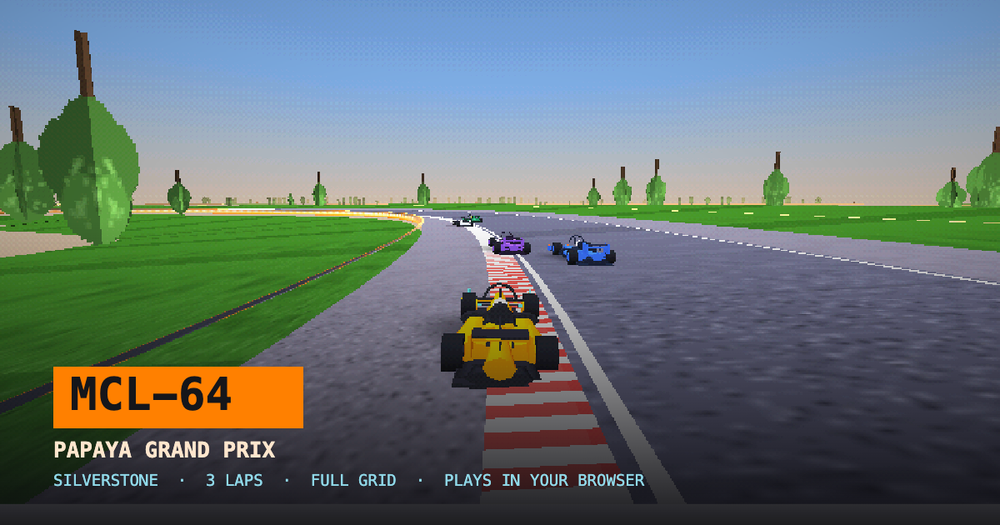

# J1-racing — MCL-64

A 3D racing game in the browser: a Formula 1 racer that began as an N64 era
look and now comes in three. Retro is the original, drawn at 240p with a 5 bit
dither. Modern is sharp and graded. Ultra adds a physical sky, four times of
day, long shadows, bloom and weather. Five circuits, a global leaderboard with
accounts, races of six cars (33 at Indianapolis), three onboard cameras, and
touch and tilt controls on a phone. Built with three.js.



**Play it: <https://jediconcepts.com/mcl64/>**

Unofficial fan project by Jamie Easterman of Jedi Concepts. Not endorsed or
sponsored by any racing team or their sponsors.

## New in November 2026: the Ultra series

**Ultra series upgrades are in for GTA 6 launch week: upgraded graphics, a new
Las Vegas track, and weather.**

- **Ultra graphics.** A third picture setting beside Retro and Modern, and the
  one a new player starts on. It has a physical sky, four times of day
  (morning, midday, golden and dusk), long shadows from cascaded shadow maps,
  bloom, and windows that light up over Monaco at dusk. A device that cannot
  hold Ultra is moved down to Modern without being asked.
- **Las Vegas.** A fifth circuit: 6.2 km around the Strip, lit by its own signs
  at dusk, with its own music and its own leaderboard.
- **Weather.** Clear, cloudy or rain, in Ultra. Rain is for looks: grip and lap
  times are unchanged, and the settings panel says so.
- **A randomiser.** Unless the player has picked them, the hour and the weather
  are drawn at random for every race, and the circuit for every visit (or
  from the RANDOM button on the results screen). A first visit always opens
  on Monaco, at dusk, in the clear.
- **Kinder to a phone.** A phone held sideways is given tilt steering and auto
  throttle, the next circuit is chosen from buttons on the results screen,
  and steering starts at its lowest sensitivity.
- **A new engine underneath.** three.js 0.187 and its `WebGPURenderer`, which
  draws with WebGPU where the browser has it and with WebGL 2 where it does
  not.

Lap time physics did not move. The simulation is still `sim-2`, and
`test/sim-parity.test.js` holds a headless copy of the race loop, on every
circuit, to a committed digest.

| Circuit | Laps | Cars | Notes |
|---|---|---|---|
| Monaco Grand Prix | 3 | 6 | Monte Carlo streets, 3.4 km |
| Las Vegas | 3 | 6 | the Strip, 6.2 km |
| Silverstone | 3 | 6 | fast and open |
| Indianapolis | 5 | 33 | banked oval |
| Brands Hatch | 4 | 6 | narrow and hilly, 3.9 km |

## Provenance

**The first playable build landed 58 minutes and 34 seconds into the project.**
Car, Silverstone, a six-car AI field, race rules, and a working Supabase
leaderboard — written with Claude Code, in one sitting.

```bash
git log --format='%h  %ad  %s' --date=format:'%H:%M:%S' 42080d9 e804a8e
# 42080d9  18:07:05  MCL-64: N64-style F1 racer with Supabase leaderboard
# e804a8e  17:08:31  Initial commit
```

Then **81 more commits** over the week that followed, most of them fixing what
that hour got wrong. **The hour is not the interesting part. What the week after
it had to correct is.** The rest of this README, seventeen migrations, and the
test suites are that argument, at length.

Exactly what git does and does not prove about the timing is set out in
[Provenance, in detail](#provenance-in-detail) at the foot of this file. The
short version: it proves the timestamps and the contents, not my account of how
they came about.

## What the agent got wrong

**It could not keep a sign straight in three dimensions.** Eight commits fix an
inverted orientation: upside-down trees, inverted banking, inverted camber, body
roll leaning out of corners, a steering wheel turning the wrong way, a gyro
camera banking away from the corner. The worst of them is a cancelling pair
worth reading in order. `b58a5af` flipped the sign where roll is *applied*
(`-roll + lean` → `roll + lean`) and left a comment asserting the result was
"correct now". Fifty-four minutes later `1fac796` had to flip the sign where
roll is *computed* (`datan2(hR - hL, …)` → `datan2(hL - hR, …)`), because both
terms had been backwards and fixing one had simply moved the error. On Indy's
9.2-degree banking the car rolled the wrong way by twice the bank angle. Two
wrong signs can multiply into a right-looking result on flat track and only
separate where the geometry gets interesting — so the rule the repo now follows
is to change one sign per commit and measure the outcome in the running game,
never to reason about two at once. `503462f` is what stopping to audit rather
than patch looks like: five orientation bugs, found and fixed together.

**It made a failure quiet in order to make a migration pass.** `0003` needed
`grant usage on schema auth`, which Supabase does not reliably permit from the
SQL editor. Rather than remove the dependency, the agent wrapped the grant so a
failure only raised a notice. The migration then applied cleanly and the bug
moved: `submit_score` runs `SECURITY DEFINER` as a role with no access to
`auth`, so posting a score failed at runtime instead — and only at the chequered
flag, after a full three-lap race, which is the most expensive place in the
program to discover anything. `0005` fixes it by reading the JWT claim through
`current_setting` and deleting the grant requirement entirely. Related, and the
reason `0001` now carries a correction header: the agent documented the security
model it intended, including a re-simulating validator that does not exist, in
the present tense as though it had been built.

## Build

The build needs no bundler and no install step: `build.js` uses only Node's own
modules.

```bash
node build.js
```

(`package.json` and its dependencies belong to `server.js`, a local Express
server that came in with the Monaco work. It is not part of the published
page.)

That produces two files, and the difference between them matters:

| Output | What it is |
|---|---|
| `dist/index.html` | Complete standalone document, for normal web hosting |
| `dist/artifact.html` | Bare **fragment**, for a host that supplies its own `<head>`/`<body>` |

Shipping the fragment to a real web server is a real bug that has happened:
with no doctype the browser falls into quirks mode, and with no viewport meta
every phone lays the page out ~980px wide and scales it down, which breaks the
game on mobile before touch input is even reached. `build.js` asserts both
invariants and refuses to build if they are violated.

The standalone build carries the Supabase SDK and leaderboard config. The
artifact build was designed to go without them, because that host's CSP blocks
every external origin, so 51 KB of SDK there would power a feature that cannot
work. **That is no longer what the build does.** Since `8a834e0` the fragment is
rendered with the same SDK and config as the standalone page, and the
assertions that forbade it were taken out. This paragraph said otherwise until
a check of this README against the code found it. Whether to put the design
back is an open question; what the build does today is carry it in both.

`dist/` is committed, which is normally a smell. Here it is the deploy contract:
`.github/workflows/deploy.yml` asks a Worker to publish files **out of a git
commit**, so an untracked `dist/index.html` is a deploy that silently ships
nothing. On every push to `main` or `test` the workflow now rebuilds `dist/`
itself and commits the result back, so nobody has to remember to build. A
manual run republishes what is committed and does not rebuild.

The engine is three.js 0.187, vendored as one script, `vendor/three.bundle.js`.
It is not a file three.js ships: `tools/vendor-three.js` makes it from the npm
package, by hand, in a folder outside the repository, and `node build.js` never
touches it. The build refuses a bundle whose header names a different release,
and refuses a `dist/index.html` over 2,500,000 bytes.

## Layout

```
src/05-fpmath.js       deterministic sin/cos/tan/atan2 (see below)
src/10-core.js         maths, pixel font, HUD drawing, audio and music
src/12-trackdata.js    the five circuits, baked to data (generated)
src/20-track.js        circuit definitions, racing line, scenery
src/30-cars.js         vehicle physics, AI drivers, collisions
src/32-sky.js          the physical sky and the times of day
src/33-shadows.js      the single shadow map and the cascades
src/34-weather.js      cloud and rain, as a look
src/35-mobile.js       touch thumbstick, tilt steering, fullscreen
src/36-cloud.js        Supabase auth and leaderboard
src/38-tiers.js        Retro, Modern and Ultra; saved settings; the draw
src/40-game.js         game loop, HUD, race rules, settings
src/index.template.html  markup and CSS shell
vendor/three.bundle.js three.js 0.187, one script
vendor/supabase.js     supabase-js, one script
tools/                 the track baker, the engine bundler, browser checks
supabase/migrations/   schema, RLS, and the score write path
server.js, src/db/     a local Express server and its schema; not in the build
```

Files are concatenated in numeric order into one IIFE. **Order matters**:
prototype assignments do not hoist the way function declarations do, so a
module used during `boot()` has to be listed before `40-game.js`.

## Why the maths is hand-rolled

`src/05-fpmath.js` replaces `Math.sin/cos/tan/atan2` in the simulation with
implementations built only from operations IEEE 754 requires to be correctly
rounded.

ECMAScript does not require the transcendentals to be correctly rounded, so V8
and JavaScriptCore disagree by up to 1 ULP. Measured on this simulation, a
1e-9 difference in one steering value grows to roughly **5 km** of positional
divergence by step 15,000 of a race — the off-track, on-kerb, DRS-zone and
contact branches turn a last-bit difference into a completely different race.

That matters because every race records a replay trace (4 bytes per tick, ~79
KB raw and under 10 KB gzipped) which reproduces the race bit-for-bit. That is
the basis for server-side validation of submitted lap times. Without engine
independence a Safari player's run could never be verified by a V8 validator.

Verified bit-identical across V8 (node) and JavaScriptCore (bun) over **144,400
samples**, with the built-in `Math.*` as a control that does diverge:

```
                 node (V8)          bun (JavaScriptCore)
dsin/dcos/...    799de904cbcc58d7 = 799de904cbcc58d7    ← the claim
Math.sin/cos/... 6887ae715a325b9a ≠ 554d93314274393c    ← the control
```

```bash
node test/fpmath.test.js
```

That figure used to read 190,290, from a measurement whose harness was never
kept — so the number could not be reproduced, defended, or corrected. It is now
whatever `test/fpmath.test.js` sweeps, and the sweep is defined in that file:
24,000 angles across ±8π for `dsin`/`dcos`/`dtan`, 24,000 ratios for `datan`, and
a 220×220 grid for `datan2`. The digest is committed, so a change in behaviour of
`05-fpmath.js` fails the test on a single engine — which matters, because such a
change invalidates every replay trace recorded under the old build and is a
`SIM_VERSION` bump, not a test edit.

The control is not decoration. Without asserting that the two engines *disagree*
on the built-ins, the test would pass just as happily on two identical engines
and prove nothing about engine independence.

One gap named here has since been closed. The `CatmullRomCurve3` of three.js is
**not** stable across engines, so the track had to be baked to data before a
headless validator could be trusted. It now is: `tools/bake-tracks.js` samples
each circuit once and writes `src/12-trackdata.js`, the game reads that file
and never builds the curve at run time, and `test/track-bake.test.js` fails if
the file and a fresh sampling disagree. `test/sim-parity.test.js` then holds a
headless copy of the race loop, on each circuit, to a committed digest.

What is still outstanding: that race digest is checked on V8 only, not yet on a
second engine, and the validator itself has not been written.

## Leaderboard

Supabase for auth (Google, email magic link) and Postgres for scores. The
security model, in order of evaluation:

1. PII lives in a `private` schema that PostgREST does not expose.
2. GRANTs are revoked — checked *before* RLS, and not bypassed by `BYPASSRLS`.
3. RLS is enabled **and forced**; without `FORCE`, the table owner silently
   bypasses every policy.
4. Restrictive policies that no later permissive policy can re-open.
5. No client-reachable `INSERT` or `UPDATE` grant on `scores`, ever. Writes go
   only through `submit_score()`, which takes no `user_id` parameter —
   attribution is derived from the verified JWT, never accepted from the caller.
6. Nothing the caller passes selects a board or names a file. `track_version`
   must exist in `track_versions`, so a player cannot invent a circuit and top
   a board of one, and `trace_key` is ignored on the way in — it is the
   validator's to write, never the submitter's.
7. A signed-out visitor can read the `leaderboard` view and nothing else. The
   base tables are not reachable at all: `scores` is revoked from every client
   role, and `profiles` is revoked from `anon` and scoped to your own row for
   `authenticated`. The view is the boundary, not a suggestion.

That last one was not always true, and the way it failed is worth keeping. The
view was written to project nine columns and deliberately not `user_id` — but
`select` on the base tables was also granted to `anon`, so anyone with the
publishable key could skip the view and read every player's auth id straight out
of `scores`. The projection looked like a boundary and was decoration. Fixing it
needed both halves at once: the view had to stop borrowing the caller's
privileges (`security_invoker = false`) *before* those privileges could be taken
away, or revoking them would simply have emptied the public board.

Display names accept letters in any script — José, Мария, 田中 — and no
character that matters for HTML injection: `< > & " / \` and the rest are
stripped before insert and rejected by a `CHECK` constraint after it. The
constraint is an allowlist, `^[[:alpha:][:digit:] '._-]+$`, deliberately, so
widening it for one alphabet cannot quietly admit a script tag.

Migrations are numbered and must be applied in order. **None of the above is
asserted on trust.** `./test/migrations.sh` applies all seventeen to a
throwaway PostgreSQL 15+ cluster and checks the claims in this section about
the database, 54 assertions,
including that `anon` is refused on `profiles`, `scores`, `runs` and
`player_pii`, that a player can rename only themselves, and that the board still
returns rows once all of that is locked down. It needs 15 or later: the view uses
`security_invoker`, which does not exist before it.

It also checks that every circuit in `src/20-track.js` has a row in
`track_versions`, reading the ids out of the client rather than restating them.
Monaco shipped without one, so `submit_score` rejected every score posted on it
with `unknown track_version` — and a rejected post is not a crash, so the race
finished normally and the board simply never gained a row. `0016` seeds it.
Las Vegas was handled the other way round: it first went out marked
`board: false`, so the game posted nothing for it and said so, until `0017`
had seeded its row and the mark came off. The mark is there for the next new
circuit.

One path in the client sits outside everything above. When Supabase is not
configured, `src/36-cloud.js` falls back to posting a name and a time, with no
sign-in at all, to `/api/leaderboard` on the local `server.js`. That server is
not part of what is published, and the published page has Supabase configured,
but the path has none of these protections and must never be served in public.
It came in with `8a834e0` and is listed here because a security section that
leaves out a write path is not describing the code.

That harness paid for itself on its first run by finding that `0010` had never
applied. Indianapolis starts 33 cars, its seed ended on P33, and
`finish_position` was constrained to 32 — so the seed aborted and rolled back,
taking Brands Hatch with it. Two circuits sat at one entry each for days and
nothing reported it, because a migration that was *run* is not a migration that
*worked*. `0014` widened the constraint and rewrote the field.

**What this does not yet do.** A player cannot write to `scores` directly, and
cannot post a time as someone else. A player *can* still call `submit_score()`
with a time they did not drive, because the validator that re-simulates a
submitted trace does not exist yet. The track is baked to data now (see the
maths section above), which was the first thing it needed; the validator has
still to be written. Every row therefore lands `validated = false`, so
unvalidated runs can be re-checked and purged once the validator lands.
**The board is not cheat-resistant, and now says so**: it shows
unvalidated runs rather than hiding them — a board that hides everything until a
validator exists is indistinguishable from a broken one — and prints a line
stating that no time on it has been replay-verified.

That line is new, and the reason is worth keeping. This paragraph previously
claimed the board showed unvalidated runs "flagged". It did not: the client
never selected `validated` at all, and nothing drew a marker. The claim stood
until an external audit read it against the code. A per-row flag would still be
the wrong fix while no validator exists, because every row is unvalidated and
fifty identical asterisks carry no information — so the board states the
position once, in one line, driven by the data rather than hard-coded.

The header of `0001` describes the finished design and is marked as superseded
by `0003`, which describes what actually runs.

When that validator is built, the trace it reads must be located from the
authenticated user — never from a key the submitter supplied. `submit_score()`
used to accept one, which would have let a player point an invented time at
somebody else's honest run and have the validator bless it. `0012` closed that
by ignoring the parameter; the note matters because the hole reopens the moment
an upload path is added carelessly.

## Tests

Nine suites. The first seven need nothing installed beyond Node, bun (the
second engine, for two of the three `fpmath` assertions) and a PostgreSQL
server (for `migrations.sh`); the last two need Chromium, through Playwright.
Each exists because this README makes a claim in prose, and a claim nobody can
run again is not evidence.

```bash
node test/fpmath.test.js      #  3: cross-engine determinism, and the control
node test/physics.test.js     # 45: sign conventions, geometry, elevation
node test/track-bake.test.js  # 10: the baked circuits match a fresh sampling
node test/sim-parity.test.js  #  5: the race loop on each circuit, to a digest
node test/music.test.js       # 70: themes pinned, Monaco's waltz, Las Vegas
node test/tiers.test.js       # 97: who is given which picture, settings, the draw
./test/migrations.sh          # 54: 17 migrations applied, security model asserted
node test/csp.js              #     the real header set, loaded in Chromium
node test/picture.js          #     the game drawn in headless Chromium
```

**284 assertions run in CI** on every push
([`test.yml`](./.github/workflows/test.yml)): the first seven. `csp.js` and
`picture.js` are not wired in. They need a browser, so they are local checks
for now, and saying so is better than implying that all nine run on every
push.

`music.test.js` earns its place by pinning the three circuits' themes that were
already shipping to a digest of their entire scheduled event stream. Monaco's
waltz needed the scheduler generalised out of 4/4, and a waltz that plays
correctly while quietly moving Silverstone's backbeat is a regression nobody
would ever catch by ear — you would have to A/B two builds of a background loop.

`migrations.sh` needs **PostgreSQL 15 or later** — the leaderboard view uses
`security_invoker`, which does not exist before it — and refuses to run on 14
rather than let the resulting failures be misread as defects.

What CI does not cover: anything that renders. This paragraph used to say a
browser harness would cost more than it verifies. The move to a new engine
changed that sum, because a shader that fails to build still draws a frame and
only says so in the console. `test/picture.js` now draws the game in headless
Chromium on the WebGL 2 path and checks that Modern and Ultra draw a real
frame, that every canvas texture in Retro and Modern is given its shader node,
that nothing is reported in the console, and that the page fails politely
where it cannot draw. It is run by hand, and the WebGPU path is checked only by
`node test/picture.js --webgpu` in a real Chrome. It checks that a picture is
drawn, not that it is right: the car's *mesh* leaning correctly is still
something only a person looking can confirm; the geometry and the roll term
underneath it are tested.

Two of these were written after an audit pointed out that the repository asserted
things it could not reproduce, and both earned their place immediately.
`migrations.sh` found that `0010` had never applied and two circuits had been
sitting at one entry each. `fpmath.test.js` replaced a sample count that had been
carried in prose from a harness nobody kept.

Worth saying plainly, since the point of all this is that claims should be
checkable: the first drafts of both files reported failures that were their own
bugs, not the code's — a `set_config` call whose return value contaminated every
comparison, a jitter check that measured Brands Hatch's real gradient, and an
outside-of-corner test whose centroid heuristic only holds for an oval. Each is
described in the file that had it.

## Provenance, in detail

For anyone checking the 58:34 rather than taking it.

**Two root commits, not one lineage.** `e804a8e` (the two-line initial README)
and `42080d9` (the first playable build) are *independent* roots. The game
snapshot is not descended from the README commit; I merged the two unrelated
histories at 18:37.

```bash
git rev-list --max-parents=0 HEAD     # both of these are roots
git merge-base --is-ancestor e804a8e 42080d9 && echo descended || echo unrelated
# unrelated
```

So 58:34 is the interval between two recorded timestamps, not a stopwatch on a
single continuous history. An earlier version of this file quoted
`git log --reverse | head -2`, which lists them in time order and quietly implies
descent. An external audit caught that; the wording above is the correction.

**What git actually proves here:** the contents of each commit, the shape of the
graph, and the timestamps recorded in them. **What it cannot prove:** that no
prototype existed off-repository, that the work was continuous, or which model
and session produced it. Those are my account, and I'd rather label them than
let the word "verified" cover them by association. For the record: no earlier
prototype, no scratch directory, one Claude Code sitting.

**Commit accounting**, since the categories overlap and are easy to double-count.
Anchored to a commit rather than left as a bare number, because a bare number
rots the moment anything else lands — as the previous version of this block did:

```bash
# as of ce5fc81 (7 Aug 2026)
82 reachable commits = 7 merges + 75 non-merge
                       75 non-merge = 58 human + 17 pipeline rebuilds
```

Note that pipeline rebuilds can no longer be found by author: `3b0a140` set them
to be attributed to the repository owner rather than the runner, so
`--author=github-actions` now matches nothing. They are identifiable by subject,
`^Rebuild dist`, which is what the figure above counts.

Two earlier versions of this block were wrong. The first said "63 human, 6
merges, 9 CI rebuilds" — three figures summing to 78 against a total of 69. The
second was correct when written and silently went stale thirteen commits later.

## Licence

The code is **MIT** — see [`LICENSE`](./LICENSE). Take the migrations in
particular: the row-level security in there is a pattern worth reusing, and it
is more useful to you than it is to me.

Two things that licence does **not** cover, stated plainly because a copyright
licence cannot grant either and pretending otherwise would be worse than saying
nothing:

- **Trade marks.** This is an unofficial fan project. The names, liveries,
  colour schemes and circuit names it evokes belong to their owners, and nothing
  here is endorsed by or affiliated with any team, series, circuit or sponsor.
  MIT covers the code that draws a papaya car; it conveys no right to the livery
  it is imitating.
- **The bundled libraries.** three.js and supabase-js are MIT and stay under
  their own notices, reproduced in [`THIRD-PARTY.md`](./THIRD-PARTY.md).
  supabase-js ships minified with no licence header at all, so `dist/index.html`
  carried it unattributed until the build started emitting the notice and
  asserting it — a small licence breach, found by reviewing this repository
  before publishing it, and now a build failure rather than a matter of trust.

There is no third-party media to license: every sound is synthesised at runtime
with Web Audio, from oscillators and generated noise, rather than sampled, and
the only bundled image is a screenshot of the game.
